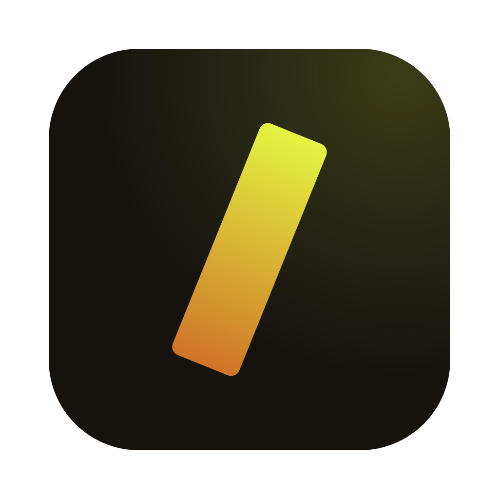

<div align="center">



# PhaseType

**Better words, right where you type.**

Select text in any Mac app, press a hotkey, and fix or rewrite it with AI.<br />
Then paste the result straight back over your selection.

[](https://github.com/its-rajesh-smp/phasetype/releases/latest)
[](https://phasetype.online/try)

[](https://github.com/its-rajesh-smp/phasetype/releases)
[](https://github.com/its-rajesh-smp/phasetype/releases)

[](https://github.com/its-rajesh-smp/phasetype/stargazers)

[Website](https://phasetype.online) · [Download](https://phasetype.online/download) · [Releases](https://github.com/its-rajesh-smp/phasetype/releases) · [Report a bug](https://github.com/its-rajesh-smp/phasetype/issues)

</div>

---

## Why PhaseType?

You're halfway through a Slack message or an email and the sentence just isn't right. Instead of copying it into a chat window, rewording it and pasting it back, you select it, press **⌘⇧Space**, and it's fixed in place.

- **No app switching.** It works where you already type.
- **No account.** Bring your own OpenAI API key. Your text goes straight from your Mac to OpenAI, with no server of ours in between.
- **No dock icon.** It sits quietly in the menu bar.

## ✨ Features

| | |
| --- | --- |
| 🖥️ **Works in every Mac app** | Mail, Slack, Notion, Xcode, a form in your browser. It reads your selection through macOS Accessibility, so apps need no plugin. |
| ⚡ **Quick fix** | Press **⌥⇧Space** to fix spelling, grammar and punctuation, and paste it straight back without opening anything. |
| 💬 **A conversation, not a one-shot** | Results stream in. Not quite right? Reply, and it refines with the whole thread in mind. |
| ✍️ **Writes from nothing** | With nothing selected, describe what you need and it pastes at your cursor. |
| 🎨 **Presets for every voice** | Save how you write a Slack reply or a client email, plus a few facts about you. Press **⌘P** in the panel to apply one. |
| 📎 **Ask about files** | Select up to five files in Finder: PDFs, Word docs, images and code. Audio is transcribed, and video is transcribed with frames read from the picture. |
| 📋 **Your clipboard, untouched** | Where apps allow it, PhaseType replaces text directly. Elsewhere it borrows the clipboard and puts it back. |
| ⌨️ **Hotkeys you choose** | Record any shortcut. PhaseType checks that no other app already uses it. |
| 📊 **Every cent counted** | Pick any chat model your key can use. Settings shows the tokens and estimated cost of each request. |

## 📦 Install

Requires macOS on Apple Silicon (M1 and later) or Intel.

### Option 1: Terminal (easiest)

```bash
curl -fsSL https://phasetype.online/install.sh | sh
```

This downloads the latest release for your Mac's chip, puts it in Applications and opens it, with no security prompts. Run it again any time to update. You can [read the script](https://phasetype.online/install.sh) first.

### Option 2: Download the .dmg

Get it from the [**latest release**](https://github.com/its-rajesh-smp/phasetype/releases/latest):

| Your Mac | File |
| --- | --- |
| Apple Silicon (M1, M2, M3, M4…) | [`PhaseType-arm64.dmg`](https://github.com/its-rajesh-smp/phasetype/releases/latest/download/PhaseType-arm64.dmg) |
| Intel | [`PhaseType-x64.dmg`](https://github.com/its-rajesh-smp/phasetype/releases/latest/download/PhaseType-x64.dmg) |

Not sure which you have? Open the Apple menu and choose **About This Mac**. "Apple M…" means Apple Silicon.

Open the .dmg and drag PhaseType into Applications.

> [!NOTE]
> Early builds aren't notarized by Apple yet, so the first time you open the app macOS says it "could not verify PhaseType". Right-click PhaseType in Applications, choose **Open**, then **Open** again. You only need to do this once per download.

## 🚀 Getting started

On first launch PhaseType walks you through three steps:

1. **Add your OpenAI API key.** It's checked with OpenAI, then stored encrypted in the macOS Keychain.
2. **Pick your hotkeys.** The defaults are `⌘⇧Space` for the panel and `⌥⇧Space` for quick fix.
3. **Grant Accessibility access.** macOS requires this before PhaseType can read your selection and paste the result.

### Shortcuts

| Action | Shortcut |
| --- | --- |
| Open the panel on your selection | `⌘⇧Space` |
| Quick fix in place | `⌥⇧Space` |
| Send a prompt | `↵` |
| Apply a preset | `⌘P` |
| Paste over the selection | `⌘↵` |
| Copy the result | `⇧⌘C` |
| Stop or close | `esc` |

## 🔒 Privacy

- Your text and files go **only to OpenAI**, directly from your Mac.
- No PhaseType servers, no account and no analytics in the app.
- Your API key is encrypted with the macOS Keychain and never reaches the UI.
- Your request history stays in a file on your Mac, and you can clear it any time.

## 🛠️ Development

This repo has two projects:

| Folder | What it is | Stack |
| --- | --- | --- |
| [`app/`](app) | The macOS app | Electron, React 19, TypeScript, Tailwind CSS v4, electron-vite |
| [`www/`](www) | [phasetype.online](https://phasetype.online), the website and browser playground | Next.js 16, React 19, Tailwind CSS v4 |

```bash
# The app
cd app
yarn
yarn dev          # run with hot reload
yarn dist:mac     # build the .dmg and .zip files into dist/

# The website
cd www
yarn
yarn dev          # http://localhost:3000
```

See [`app/README.md`](app/README.md) for how the app works, signing and the project layout, and [`www/README.md`](www/README.md) for the website.

### Releasing

1. Bump `version` in `app/package.json`.
2. From `app/`, run `GH_TOKEN=<token> yarn release:mac`. This builds both architectures and uploads them to a **draft** GitHub release tagged `v<version>`.
3. Write the notes on GitHub and publish. The website, the install script and the download links always use the latest published release.

## 🤝 Contributing

Bug reports and ideas are welcome. [Open an issue](https://github.com/its-rajesh-smp/phasetype/issues) and describe what you were doing and which app you were typing in.

---

<div align="center">

Made by [Rajesh Mahapatra](https://itsrajeshsmp.online/?utm_source=github) · If PhaseType saves you time, a ⭐ helps others find it.

</div>
